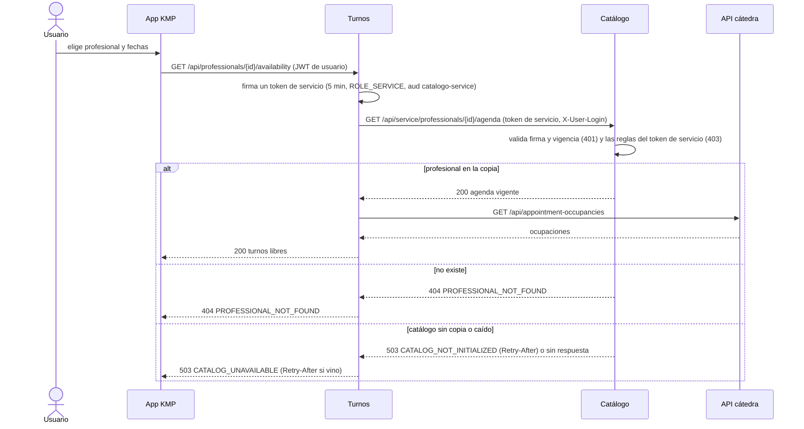

# Contratos entre los servicios de catálogo y de turnos

Qué se piden los dos servicios backend del sistema, con qué autenticación, con qué datos y qué errores.
Responde al punto del enunciado §12: "la documentación de los contratos entre los dos servicios, incluyendo
operaciones, DTO, autenticación y errores relevantes".

Hay **una sola operación entre servicios** (turnos le pide a catálogo la agenda vigente de un profesional) y
**un token compartido** (el JWT de usuario, que emite turnos y valida catálogo). Los dos servicios no comparten
base de datos ni se comunican por Kafka entre sí.

| Contrato | Quién llama | Quién responde | Autenticación |
| --- | --- | --- | --- |
| [1. Agenda vigente de un profesional](#1-agenda-vigente-de-un-profesional) | turnos | catálogo | [token técnico de servicio](#2-token-técnico-de-servicio) |
| [3. JWT de usuario](#3-jwt-de-usuario) | la app (con un token de turnos) | catálogo | el JWT del usuario, firmado por turnos |

Fuentes (verificadas contra el código de los dos repositorios):

- catálogo: `docs/use-cases/CU-07-consultar-agenda-vigente.md`, `docs/adr/0003-validacion-jwt.md`,
  `docs/adr/0007-autorizacion-token-de-servicio.md`, `ProfessionalAgendaController`, `AgendaResponse` y sus
  records, `ServiceTokenAuthorizationManager`, `TokenAuthorizations`, y el JSON fijado en
  `ProfessionalAgendaControllerIT`;
- turnos: `docs/adr/0003-emision-jwt-y-usuarios.md`, `docs/adr/0005-token-de-servicio.md`,
  `CatalogoAgendaClient`, `ServiceTokenIssuer`, `TokenAuthorizations` y `AuthenticateController`.

## 1. Agenda vigente de un profesional

Turnos no guarda el catálogo: cada vez que necesita la información vigente de un profesional (para mostrar
turnos disponibles, CU-03, o para iniciar una reserva, CU-04) se la pide al catálogo, que la tiene sincronizada
con la cátedra. Es el "obtener agenda vigente" del diagrama de reserva del contrato de la cátedra (§17).

### Pedido

```http
GET /api/service/professionals/{id}/agenda
Authorization: Bearer <token técnico de servicio>
X-User-Login: ana.perez
```

| Parte | Obligatoria | Qué es |
| --- | --- | --- |
| `{id}` | sí | El `id` del profesional en el catálogo (el mismo que en la cátedra) |
| `Authorization` | sí | Un token técnico de servicio nuevo en cada pedido ([sección 2](#2-token-técnico-de-servicio)). **Nunca** el JWT del usuario ni el de la cátedra |
| `X-User-Login` | no | El login del usuario que originó el pedido, **solo para el log** del catálogo (trazabilidad). No autoriza nada ni cambia la respuesta. Turnos lo manda solo si tiene de 3 a 50 caracteres de los que admite un login; si no, no lo manda |

### Respuesta `200 OK`

```json
{
  "catalogVersion": 57,
  "professional": {
    "id": 15,
    "firstName": "Ana",
    "lastName": "Gomez",
    "enabled": true,
    "category": { "id": 1, "name": "Clínica", "enabled": true }
  },
  "weeklySchedules": [
    { "id": 23, "dayOfWeek": "MONDAY", "startTime": "08:00:00", "endTime": "09:00:00", "slotDurationMinutes": 15 },
    { "id": 21, "dayOfWeek": "MONDAY", "startTime": "09:00:00", "endTime": "12:00:00", "slotDurationMinutes": 30 },
    { "id": 24, "dayOfWeek": "FRIDAY", "startTime": "09:00:00", "endTime": "13:00:00", "slotDurationMinutes": 30 }
  ]
}
```

| Campo | Tipo | Qué es |
| --- | --- | --- |
| `catalogVersion` | entero | La versión local del catálogo de la que salen el profesional y sus horarios (la misma lectura) |
| `professional.id`, `firstName`, `lastName` | entero, texto | El profesional |
| `professional.enabled` | booleano | Si está habilitado. Uno deshabilitado viene con `enabled: false` y `weeklySchedules: []` |
| `professional.category` | objeto | `id`, `name` y `enabled` de su categoría. Una categoría deshabilitada **se informa y la agenda va igual** |
| `weeklySchedules[]` | lista | Solo los horarios **habilitados**, ordenados de lunes a domingo, por hora de inicio y por `id` |
| `weeklySchedules[].dayOfWeek` | texto | `MONDAY` a `SUNDAY` |
| `weeklySchedules[].startTime`, `endTime` | texto | Horas **locales de atención**, siempre `HH:mm:ss` |
| `weeklySchedules[].slotDurationMinutes` | entero | La duración de cada turno de ese horario |

Turnos acepta las horas en `HH:mm` y en `HH:mm:ss` (como pide el contrato de la cátedra §4), aunque el catálogo
siempre mande segundos. Con la agenda, turnos genera los turnos de cada día y les resta las ocupaciones de la
cátedra (CU-03). La cátedra vuelve a validar el turno al reservar, así que una agenda atrasada no produce una
reserva inválida.

### Errores

| HTTP | Cuerpo | Cuándo | Cómo lo interpreta turnos |
| --- | --- | --- | --- |
| `404` | `problem+json` con `code: PROFESSIONAL_NOT_FOUND` | El profesional no está en la copia del catálogo | El profesional no existe: `404 PROFESSIONAL_NOT_FOUND` a la app. Un `404` **sin** ese `code` es respuesta inválida |
| `503` | `problem+json` con `code: CATALOG_NOT_INITIALIZED` y `Retry-After` en segundos | El catálogo todavía no tiene una copia (no pudo sincronizar). Sin `Retry-After` si su comprobación periódica está apagada | No disponible: `503 CATALOG_UNAVAILABLE` a la app, con el mismo `Retry-After` (recortado a 1 hora) si vino |
| `400` | `problem+json` | El `{id}` no es un número | No pasa: turnos siempre manda un número. Sería respuesta inválida |
| `401` | sin cuerpo | Sin token, firma inválida, vencido o sin `exp` | Error de configuración propio: `503 CATALOG_UNAVAILABLE` sin `Retry-After`, y ERROR en el log |
| `403` | sin cuerpo | El token no cumple las reglas del token de servicio (sección 2) | Ídem `401` |
| `408`, `429`, `5xx`, sin conexión o timeout | — | El catálogo no responde | `503 CATALOG_UNAVAILABLE` (con `Retry-After` si vino) |
| otro | — | Fuera del contrato | `502 UPSTREAM_INVALID_RESPONSE` |
| `200` ilegible | — | El cuerpo no respeta el DTO | `502 UPSTREAM_INVALID_RESPONSE` |

Turnos decide por `status` y `code`, nunca por el `detail`, y nunca le reenvía a la app el motivo técnico de
una falla entre servicios.

### Timeouts, reintentos y caída

| Qué | Valor | Por qué |
| --- | --- | --- |
| Conexión | 2 s (`CATALOGO_CONNECT_TIMEOUT`) | DPT-13 de turnos: el usuario está esperando |
| Respuesta completa | 5 s (`CATALOGO_READ_TIMEOUT`) | La respuesta es chica |
| Reintentos | **ninguno** | El usuario está esperando; si reintenta él, es seguro (es una consulta) |
| Si el catálogo está caído | Solo fallan CU-03 y CU-04 de turnos (`503`), **sin guardar nada**. Lo demás (consultar un proceso, mis reservas, cancelar, la reconciliación) sigue funcionando: no necesita información vigente del catálogo (DPT-11, enunciado §8) |

### Secuencia



## 2. Token técnico de servicio

Turnos **no reenvía el JWT del usuario** al catálogo: firma un token propio, de vida corta, que identifica al
servicio (DPT-16 de turnos, DP-06 del catálogo). Así el catálogo distingue una llamada de turnos de una de la app,
y un token de usuario robado no sirve para el endpoint de servicio.

| Claim | Valor | Lo exige el catálogo |
| --- | --- | --- |
| `sub` | `turnos-service` | — |
| `iss` | `turnos-service` | sí, igual |
| `aud` | `["catalogo-service"]` | sí, que lo contenga |
| `auth` | `ROLE_SERVICE` | sí, y **ningún rol de usuario** (`ROLE_USER`, `ROLE_ADMIN`) |
| `iat` | el instante de emisión | sí, presente y a lo sumo 60 s en el futuro |
| `exp` | `iat` + la vida configurada | sí, presente, y `exp − iat` de hasta 5 minutos |

- **Quién lo firma:** turnos (`ServiceTokenIssuer`), con HS512 y la **misma clave** que los tokens de usuario
  (`JWT_BASE64_SECRET`, en el entorno de los dos servicios, nunca en el código). Uno nuevo por pedido: firmar
  cuesta unos 12 µs, contra cientos de milisegundos de red.
- **Vida:** configurable con `SERVICE_TOKEN_LIFETIME` (por defecto 5 min), validada al arrancar entre 30 s y
  5 min. **Con más de 5 minutos, turnos no arranca:** el catálogo respondería `403` a cada pedido.
- **Qué valida el catálogo:** primero el decoder (firma, vigencia y que traiga `exp`; si no, `401`); después la
  regla del endpoint (`ServiceTokenAuthorizationManager`: rol, `aud`, `iss` y vida corta; si no, `403`). Las
  reglas de servicio son de **autorización** y no del decoder: puestas en el decoder darían `401` y además
  rechazarían los tokens de usuario, que no traen `aud` ni `iss`.
- **Por qué turnos rechaza sus propios tokens de servicio:** con la clave compartida, la firma prueba quién lo
  firmó pero no qué clase de token es. Turnos rechaza con `403` cualquier token con `ROLE_SERVICE` en sus
  endpoints de usuario (`/api/**`, `/api/admin/**`), y el catálogo hace lo mismo en los suyos: un token de
  servicio nunca sirve como token de usuario, ni al revés.
- **Nunca se loguea** ni llega a la app.

Limitación documentada (ADR 0003 de los dos servicios): con HS512, la vida corta acota un **token** filtrado, no
una **clave** filtrada; con la clave se puede firmar cualquier token. RS256 (turnos firma con la privada, el
catálogo valida con la pública) se descartó por costo.

## 3. JWT de usuario

Turnos es el dueño de los usuarios finales: registra, autentica (`POST /api/authenticate`) y **emite** el JWT
que la app usa con los dos servicios. El catálogo **solo lo valida**, con la misma clave.

| Claim | Valor |
| --- | --- |
| `sub` | el login |
| `auth` | los roles, **como texto separado por espacios** (`ROLE_USER` o `ROLE_ADMIN ROLE_USER`) |
| `userId` | el `id` interno del usuario en turnos (lo que autoriza en turnos, DPT-21) |
| `iat`, `exp` | emisión y vencimiento (24 h, o 30 días con "recordarme") |

Sin `aud`, sin `iss` y nunca con `ROLE_SERVICE`. Firmado con HS512 y `JWT_BASE64_SECRET`.

Qué endpoints del catálogo lo usan:

| Endpoint del catálogo | Rol |
| --- | --- |
| `GET /api/professionals` (búsqueda con filtros, CU-05) | `ROLE_USER` o `ROLE_ADMIN` |
| `GET /api/categories` (CU-06) | `ROLE_USER` o `ROLE_ADMIN` |
| `GET /api/sync/status` (CU-09) | `ROLE_USER` o `ROLE_ADMIN` |
| `POST /api/admin/sync` (CU-08) | `ROLE_ADMIN` |
| `GET /api/service/**` | **no**: solo el token de servicio |

**Un token mixto da `403` en los dos lados.** Las reglas de usuario exigen el rol de usuario **y que no esté**
`ROLE_SERVICE`; la regla de servicio exige `ROLE_SERVICE` **y ningún** rol de usuario. Un token con los dos (por
ejemplo, uno de servicio mal armado con `ROLE_ADMIN`) no sirve en ningún endpoint.

En los dos servicios: sin token, con la firma inválida, vencido o sin `exp`, `401` (el validador por defecto de
Spring dejaba pasar un token sin `exp`, que no vencería nunca; se exige explícitamente). Con un token válido sin
el rol que pide el endpoint, `403`. Los dos sin cuerpo.
